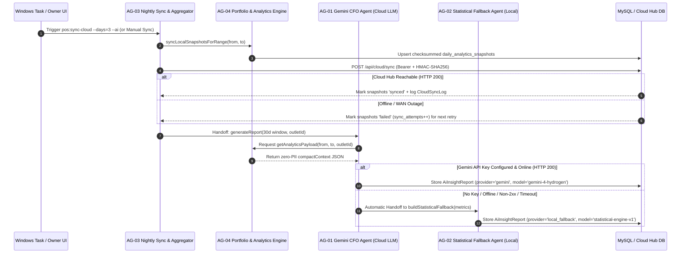

# AI Agent System Specification (`AGENTS.md`) — Royal Hotel & Restaurant Hybrid POS

> **Source of Truth Context**: Grounded strictly in [docs/prd.md](file:///d:/planned%20projects/hotel-pos-laravel/docs/prd.md) (`PRD.md`), [docs/trd.md](file:///d:/planned%20projects/hotel-pos-laravel/docs/trd.md) (`ARCHITECTURE.md`), [docs/database.md](file:///d:/planned%20projects/hotel-pos-laravel/docs/database.md) (`DATABASE.md`), and [docs/api.md](file:///d:/planned%20projects/hotel-pos-laravel/docs/api.md) (`API.md`).

---

## 1. List of All Agents and Their Purpose

Royal Hotel & Restaurant Hybrid POS operates a **multi-agent architecture** spanning **3 Runtime Production Agents** (powering the 25% Cloud AI Analytics, Offline Resilience, and Nightly Sync layer) and **2 Development & Maintenance Agents** (powering schema, test, and codebase evolution):

| Agent ID | Agent Name | Implementation Layer | Core Purpose |
|---|---|---|---|
| **AG-01** | **Hospitality CFO & Operations Analyst Agent** | `App\Services\GeminiAnalyticsService` (`callGeminiInteractionsApi`) | Analyzes verified Indian hotel POS telemetry via Google Gemini (`gemini-4-hydrogen`, Interactions API `v1`) to produce structured `0–100` Health Scores, Executive Summaries, Leakage Risks, Margin Recommendations, and Investor Narratives. |
| **AG-02** | **Offline Statistical Fallback Agent** | `App\Services\GeminiAnalyticsService` (`buildStatisticalFallback`) | Zero-latency, zero-internet deterministic analytics agent (`statistical-engine-v1`) that takes over automatically whenever the hotel is offline, no Gemini key is configured, or the LLM API times out. |
| **AG-03** | **Nightly Cloud Sync & Telemetry Aggregator Agent** | `App\Console\Commands\SyncPosCloudCommand` + `App\Services\CloudSyncService` + `App\Services\AnalyticsService` | Autonomous `01:00 AM` background agent that computes SHA-256 checksummed daily snapshots (`daily_analytics_snapshots`), signs HMAC-SHA256 payloads, syncs local outlets to the live Cloud Hub (`POST /api/cloud/sync`), manages the offline retry queue, and triggers nightly AI reports. |
| **AG-04** | **Multi-Outlet Portfolio Benchmarking Agent** | `App\Services\AnalyticsService` (`getAnalyticsPayload`) + `App\Http\Controllers\InvestorPortalController` | Consolidates multi-branch telemetry on `POS_MODE=cloud_hub`, calculates Period-over-Period Growth % and Annualized Run Rate (ARR), and serves sanitized read-only executive reports to tokenized `/investor/{token}` portals. |
| **AG-05** | **Laravel Boost Development & QA Agent** | `.mcp.json` (`php artisan boost:mcp`) + `CLAUDE.md` | Assists engineers with live schema inspection, route verification, Laravel 13 code generation, Pint formatting, and automated PHPUnit verification. |

---

## 2. Responsibilities and Capabilities of Each Agent

### AG-01: Hospitality CFO & Operations Analyst Agent (`gemini`)
- Ingests pre-aggregated, zero-PII financial telemetry (`period`, `kpis`, `payment_split`, `top_categories`, `top_dishes`, `veg_nonveg`, `outlet_comparison`) in INR (`₹`).
- Evaluates unit economics: Average Order Value (AOV), Annualized Run Rate (ARR), Digital Payment Share (UPI + Card %), Discount Leakage %, Cancellation Rate %, Peak Dining Hour bottlenecks, and Veg/Non-Veg mix.
- Enforces strict JSON Schema output via the Gemini Interactions API (`v1`) and persists verified reports into `ai_insight_reports`.

### AG-02: Offline Statistical Fallback Agent (`local_fallback`)
- Guarantees **100% availability** of the `/owner/analytics` and `/investor/{token}` AI Insights panel even during multi-day WAN internet outages.
- Applies a deterministic hospitality scoring rubric (`base = 68`, adjusted by order volume, revenue growth %, digital UPI share `>= 35%`, discount discipline `<= 4%` vs `> 8%`, and cancellation rate `> 5%`, clamped to `25–98`).
- Generates data-backed INR highlights, leakage warnings, peak-hour prep recommendations, and investor due-diligence narratives.

### AG-03: Nightly Cloud Sync & Telemetry Aggregator Agent
- Scans local `orders` (`paid` and `cancelled`) and `order_items` across the lookback window (`--days=3` nightly or `1–90` manual).
- Builds idempotent `daily_analytics_snapshots` rows keyed by `UNIQUE(outlet_id, business_date)` with SHA-256 `payload_checksum` change detection.
- Signs outbound sync payloads with `Authorization: Bearer <token>` and `X-POS-Signature: HMAC-SHA256(timestamp + "." + rawJson, token)`.
- Automatically queues failed days (`sync_status = 'failed'`, increments `sync_attempts`) and retries on the next run.

### AG-04: Multi-Outlet Portfolio Benchmarking Agent
- Aggregates cross-branch snapshots on `POS_MODE=cloud_hub`, ranking sister hotels (`ROYAL-YTL-01`, `ROYAL-PUN-02`, etc.) by Net Revenue, AOV, Discount %, and UPI Share %.
- Enforces investor link access guards (`is_active`, `expires_at`), tracks `views_count` and `last_viewed_at`, and auto-triggers AG-01/AG-02 if an investor opens a link before an AI report exists for that scope.

### AG-05: Laravel Boost Development & QA Agent
- Inspects live MySQL/SQLite tables, runs read-only database queries, checks Laravel 13 documentation, formats modified PHP files with `vendor/bin/pint`, and executes `php artisan test --compact`.

---

## 3. Tools and MCP Servers Each Agent Can Use

| Agent | Runtime Tools / Services | MCP Servers Available |
|---|---|---|
| **AG-01 (Gemini CFO Agent)** | `Illuminate\Support\Facades\Http` (`POST https://generativelanguage.googleapis.com/v1/interactions`), `AnalyticsService::getAnalyticsPayload`, `AiInsightReport::create`, `PosService::logAudit` | `gemini-api_gemini-api-docs` (`gemini_search_docs`, `gemini_get_doc` for schema/model updates) |
| **AG-02 (Offline Statistical Agent)** | `PosService::formatINR`, `AnalyticsService::getAnalyticsPayload`, `AiInsightReport::create` | None required (100% local deterministic PHP execution) |
| **AG-03 (Nightly Cloud Sync Agent)** | `AnalyticsService::buildDailySnapshot`, `CloudSyncService::syncOutbound`, `CloudSyncService::ingestInbound`, `Http::withToken()`, `CloudSyncLog::create`, Windows Task Scheduler (`schtasks`) | `laravel-boost` (`database-query`, `read-log-entries`) |
| **AG-04 (Portfolio & Investor Agent)** | `AnalyticsService::getAnalyticsPayload`, `InvestorShareLink::isAccessible`, `public/js/pos-charts.js` (Offline SVG Chart Engine) | `laravel-boost` (`get-absolute-url`, `list-routes`) |
| **AG-05 (Laravel Boost Dev Agent)** | `php artisan test --compact`, `vendor/bin/pint --dirty --format agent`, `php artisan route:list`, `php artisan migrate` | `laravel-boost` (`application-info`, `database-schema`, `database-query`, `list-routes`, `search-docs`, `browser-logs`, `tinker`), `gemini-api_gemini-api-docs` |

---

## 4. Triggers and When Each Agent Runs

| Agent | Trigger Type | Exact Trigger Mechanism |
|---|---|---|
| **AG-01 & AG-02** | **On-Demand UI** | Owner clicks **Generate AI Executive Insights** (`POST /owner/analytics/generate-ai`). |
| **AG-01 & AG-02** | **Nightly Scheduled** | Triggered at `01:00 AM` when `php artisan pos:sync-cloud --days=3 --ai` runs via `routes/console.php` / `RoyalHotelPOS_NightlyCloudSync`. |
| **AG-01 & AG-02** | **Lazy Investor Load** | Triggered automatically on `GET /investor/{token}` if `include_ai_insights = true` and no cached `AiInsightReport` exists for the outlet/portfolio. |
| **AG-03** | **Nightly Cron / Task** | Runs daily at `01:00 AM` (`config('pos.cloud_sync.nightly_time', '01:00')`) with `withoutOverlapping()`. |
| **AG-03** | **Manual UI / CLI** | Owner clicks **Sync Nightly Snapshots Now** (`POST /owner/analytics/sync-now`) or runs `php artisan pos:sync-cloud --days=7 --ai --manual`. |
| **AG-03 (Inbound)** | **Webhook / REST** | Remote outlet sends `POST /api/cloud/sync` to the central Cloud Hub. |
| **AG-04** | **HTTP Request** | Owner opens `GET /owner/analytics` or external investor opens `GET /investor/{token}`. |

---

## 5. Input and Output Format for Each Agent

### 5.1 AG-01 & AG-02 Input Context Schema (`compactContext` JSON)
```json
{
  "business_name": "Royal Family Restaurant & Hotel",
  "period": { "from": "2026-10-24", "to": "2026-11-22", "days": 30, "active_selling_days": 28 },
  "kpis": {
    "revenue": 842500.0,
    "gross_sales": 815000.0,
    "discount_total": 14500.0,
    "discount_rate_pct": 1.78,
    "gst_total": 42000.0,
    "orders": 1240,
    "dine_in_share_pct": 82.5,
    "takeaway_share_pct": 17.5,
    "avg_bill": 679.44,
    "cancel_rate_pct": 0.8,
    "digital_share_pct": 61.4,
    "revenue_growth_pct": 14.2,
    "annualized_run_rate": 10982589.29,
    "peak_hour_label": "8pm",
    "outlets_count": 2
  },
  "payment_split": [
    { "label": "Cash", "amount": 325205.0, "pct": 38.6 },
    { "label": "UPI / Digital", "amount": 465060.0, "pct": 55.2 },
    { "label": "Card", "amount": 52235.0, "pct": 6.2 }
  ],
  "top_categories": [{ "name": "Main Course", "qty": 1820, "revenue": 412000.0, "pct": 48.9 }],
  "top_dishes": [{ "name": "Paneer Butter Masala", "qty": 640, "revenue": 153600.0, "is_veg": true }],
  "veg_nonveg": { "veg_pct": 68.4, "nonveg_pct": 31.6 },
  "outlet_comparison": [
    { "outlet_code": "ROYAL-YTL-01", "name": "Royal Family Restaurant", "revenue": 512500.0, "orders": 760, "avg_bill": 674.34 }
  ]
}
```

### 5.2 AG-01 & AG-02 Strict Output JSON Schema (`AiInsightReport`)
```json
{
  "executive_summary": "Royal Family Restaurant & Hotel delivered ₹8,42,500 across 1,240 settled bills (₹679.44 AOV, +14.2% PoP)...",
  "health_score": 89,
  "highlights": [
    "Generated ₹8,42,500 across 1,240 settled bills (+14.2% vs prior 30-day window).",
    "Digital payment adoption (UPI + Card) reached 61.4%, providing strong bank-verifiable cash flows."
  ],
  "risks": [
    "Peak dinner demand concentrates heavily at 8pm — kitchen ticket velocity during 8pm-10pm is the primary table-turnover constraint."
  ],
  "recommendations": [
    "Pre-portion top-selling Paneer Butter Masala gravies before 7:30pm to cut KDS ticket times by 4 minutes.",
    "Bundle star Main Course dishes with Masala Chaas / Gulab Jamun to lift AOV from ₹679 toward ₹760."
  ],
  "investor_narrative": "Operating across 2 connected outlets on a 75% offline LAN / 25% cloud sync architecture, the business paces at a ₹1,09,82,589 annualized run rate with 61.4% digital payment traceability and 1.78% discount discipline."
}
```

### 5.3 AG-03 Outbound Sync Input / Output Format
- **Input**: Collection of `DailyAnalyticsSnapshot` records with `sync_status IN ('pending', 'failed')` + local `Outlet` metadata.
- **Output**: Signed HTTPS request to `POST /api/cloud/sync` returning `{"ok": true, "outlet_code": "ROYAL-YTL-01", "upserted": N, "server_time": "..."}` and persisted `CloudSyncLog` record.

---

## 6. Agent Prompt Templates (System Prompts)

### 6.1 AG-01 Hospitality CFO & Operations Analyst Prompt (`GeminiAnalyticsService.php`)
```text
You are a hospitality CFO and restaurant operations analyst reviewing verified Indian hotel POS telemetry for {hotel_name}.
Analyze the metrics JSON below and produce concise, investor-grade insights in INR (₹).
Be concrete, cite actual numbers, highlight unit economics, digital UPI adoption, discount/cancellation leakage, peak-hour staffing, and expansion readiness.

METRICS JSON: {json_encoded_compact_context}
```
Enforced with Gemini Interactions API `response_format`:
- `type`: `"text"`
- `mime_type`: `"application/json"`
- `schema`: Strict 6-field JSON Schema (`executive_summary`, `health_score`, `highlights`, `risks`, `recommendations`, `investor_narrative`).

---

## 7. How Agents Collaborate and Handoff Tasks



---

## 8. Memory and Context Management Strategy

1. **Pre-Aggregated Daily Rollups (`daily_analytics_snapshots`)**: Instead of feeding thousands of raw `orders` and `order_items` rows into the AI context window, AG-03/AG-04 compress each business day into a single checksummed row. This keeps the prompt context under `4 KB` regardless of whether the period spans 7 days or 365 days.
2. **Top-K Context Pruning**: `GeminiAnalyticsService` slices `category_mix` and `top_dishes` to the top 6 items (`array_slice(..., 0, 6)`) before calling the LLM, eliminating long-tail token noise while preserving >85% of revenue signal.
3. **Persistent Report Caching (`ai_insight_reports`)**: Generated insights are stored in `ai_insight_reports` with a frozen `metrics_snapshot` JSON column. Subsequent loads of `/owner/analytics` and `/investor/{token}` read the cached report in `< 5 ms` without burning LLM quota on every page view.

---

## 9. Guardrails and Safety Rules

1. **Strict Zero-PII Transmission**: `customer_phone`, `customer_name`, staff `pin_code`, and raw free-text order notes are **never** included in `DailyAnalyticsSnapshot::toSyncPayload()` or `GeminiAnalyticsService` prompts.
2. **Health Score Clamping**: Both AG-01 (`max(0, min(100, (int) $parsed['health_score']))`) and AG-02 (`max(25, min(98, $score))`) clamp health scores to valid integer bounds before database insertion.
3. **Read-Only Financial Integrity**: AI and Analytics agents (`AG-01`–`AG-04`) have **zero write access** to transactional billing tables (`orders`, `kots`, `order_items`). Only `PosService` inside ACID `DB::transaction()` blocks can mutate bills.
4. **Constant-Time Cryptographic Verification**: Inbound sync requests to AG-03 verify both the Bearer token and `X-POS-Signature` HMAC using `hash_equals()` to prevent timing attacks.
5. **Owner-Only Execution Guard**: Triggering AI generation (`POST /owner/analytics/generate-ai`), manual sync (`POST /owner/analytics/sync-now`), or share link creation (`POST /owner/analytics/share-links`) is protected by `pos.auth:owner`.

---

## 10. Error Handling and Retry Logic

- **LLM Circuit Breaker (`AG-01` → `AG-02`)**:
  - HTTP timeout is capped at `25 seconds` (`config('pos.gemini.timeout_seconds', 25)`).
  - Any network exception (`Throwable`), non-2xx HTTP status, malformed JSON output, or missing `executive_summary` key is caught cleanly, logged via `Log::warning()`, and handed off to `buildStatisticalFallback()` within the same request cycle. The user never sees a 500 error.
- **Nightly Sync Offline Queue (`AG-03`)**:
  - HTTP timeout is capped at `15 seconds` (`config('pos.cloud_sync.timeout_seconds', 15)`).
  - If the hotel's internet is down or the Cloud Hub returns HTTP `4xx/5xx`, `markSnapshotsFailed()` sets `sync_status = 'failed'`, increments `sync_attempts`, and stores the first 500 characters of `last_sync_error`.
  - Next time `pos:sync-cloud` runs, the query `whereIn('sync_status', ['pending', 'failed'])` automatically picks up all previously failed days and syncs them in chronological order.
- **Scheduler Overlap Prevention**: `routes/console.php` applies `->withoutOverlapping()` to `pos:sync-cloud` so a slow network connection cannot spawn concurrent sync workers.

---

## 11. Logging and Observability for Agent Actions

Every agent action is observable across three dedicated layers:
1. **Anti-Theft Audit Trail (`audit_logs` table — `/owner/audit`)**:
   - Records `ai_insight_generated` (with `provider`, `model`, `period`, `health_score`), `cloud_sync_completed` (with `snapshots` count and `http_status`), and `investor_link_created` / `investor_link_toggled` / `investor_link_deleted`.
2. **Cloud Sync Telemetry (`cloud_sync_logs` table — `/owner/analytics`)**:
   - Tracks every `outbound` and `inbound` run with `trigger_type` (`scheduled`, `manual`, `api`), `status` (`success`, `failed`, `skipped`), `snapshots_count`, `http_status`, `duration_ms`, and human-readable `message`.
3. **Application Diagnostics (`storage/logs/laravel.log`)**:
   - Captures structured `Log::warning()` entries whenever Gemini API calls degrade to the local statistical fallback.

---

## 12. Human-in-the-Loop Points

1. **Counter Discounts & Cancellations**: Require explicit Cashier/Owner action with a mandatory human-entered reason logged in `audit_logs`.
2. **AI Recommendations Execution**: AG-01/AG-02 surface menu pricing, combo bundling, and peak-hour prep recommendations on `/owner/analytics`, while actual menu price or stock changes require Owner confirmation in **Owner → Menu** (`/owner/menu`).
3. **Investor Link Governance**: Only the Owner (`1111`) can mint, set expiration windows on, or revoke `/investor/{token}` share links.
4. **Manual Sync & AI Refresh**: Owners can override the `01:00 AM` schedule anytime via **Sync Nightly Snapshots Now** or **Generate AI Executive Insights**.

---

## 13. Scalability Considerations

- **O(Days) Query Scaling**: Because `AnalyticsService` queries `daily_analytics_snapshots` (1 row per outlet per day) rather than raw `orders`/`order_items`, rendering 90-day or 365-day charts across 20 hotel branches scans at most `7,300` compact rows.
- **Multi-Outlet Horizontal Topology**: Dozens of independent local hotel outlets (`POS_MODE=outlet`) operate with zero cross-branch contention during peak dinner hours and batch-upload compact JSON payloads (`~3 KB/day`) to a single central `POS_MODE=cloud_hub` server at night.
- **Zero-CDN Client Rendering**: `public/js/pos-charts.js` renders vector SVG charts purely on the client CPU in `< 10 ms`, placing zero image-rendering load on the PHP server.

---

## 14. Example Agent Workflows for Key User Journeys

### Journey A: Nightly 01:00 AM Autonomous Sync & AI Refresh
1. At `01:00 AM`, Windows Task Scheduler runs `php artisan pos:sync-cloud --days=3 --ai`.
2. **AG-03** recalculates the last 3 days of local orders into `daily_analytics_snapshots`. Today's snapshot has a new SHA-256 checksum, so its `sync_status` is `pending`.
3. **AG-03** signs the payload with HMAC-SHA256 and POSTs it to the live Cloud Hub (`POST /api/cloud/sync`).
4. The Cloud Hub verifies the signature, upserts the snapshot for `ROYAL-YTL-01`, and returns `200 OK`.
5. **AG-03** marks local snapshots `synced` and invokes **AG-01** (`GeminiAnalyticsService::generateReport`).
6. **AG-01** calls `gemini-4-hydrogen`, receives a `91/100` Health Score and updated investor narrative, and saves a new `AiInsightReport`.

### Journey B: Owner Shares Live Performance Link with an Investor While Offline
1. Owner logs in with PIN `1111` on the hotel counter PC (or Cloud Hub) and opens `/owner/analytics`.
2. Even if WAN internet is temporarily offline, **AG-04** renders all 6 SVG charts from local snapshots, and **AG-02** (`Offline Statistical Engine`) generates an instant executive report (`Health Score: 84/100`).
3. Owner creates a share link titled `"Series Seed Data Room — Q4"` for investor `" Peak XV / Angel Syndicate"` with a 30-day window and 14-day expiry.
4. Investor opens `/investor/{token}` on their laptop, views verified revenue growth, UPI digital share %, multi-outlet comparison, and AI executive narrative, and clicks **Print / Save Investor PDF**.

---

<laravel-boost-guidelines>
=== foundation rules ===

# Laravel Boost Guidelines

## Foundational Context

This application is a Laravel application running on PHP 8.5. Always use the APIs that match the installed major version of each package — do not assume a version.

Before relying on a package's API, confirm its installed version:
- PHP packages: run `composer show --direct` to list direct dependencies with versions, or `composer show <vendor/package>` for a single package.
- JS packages: check `package.json` for the installed versions.

## Conventions

- You must follow all existing code conventions used in this application. When creating or editing a file, check sibling files for the correct structure, approach, and naming.
- Use descriptive names for variables and methods. For example, `isRegisteredForDiscounts`, not `discount()`.
- Check for existing components to reuse before writing a new one.

## Verification Scripts

- Do not create verification scripts or tinker when tests cover that functionality and prove they work. Unit and feature tests are more important.

## Application Structure & Architecture

- Stick to existing directory structure; don't create new base folders without approval.
- Do not change the application's dependencies without approval.

## Frontend Bundling

- If a frontend change doesn't show in the UI or you get a "Unable to locate file in Vite manifest" error, run `npm run build` or ask the user to run `npm run dev` or `composer run dev`.

=== boost rules ===

# Laravel Boost

- Prefer Laravel Boost MCP tools (`database-query`, `database-schema`, `get-absolute-url`, `browser-logs`, `search-docs`) when available.
- Inspect routes with `php artisan route:list`.
- If you have modified any PHP files, run `vendor/bin/pint --dirty --format agent` before finalizing changes.
- Run tests using `php artisan test --compact`.
</laravel-boost-guidelines>
