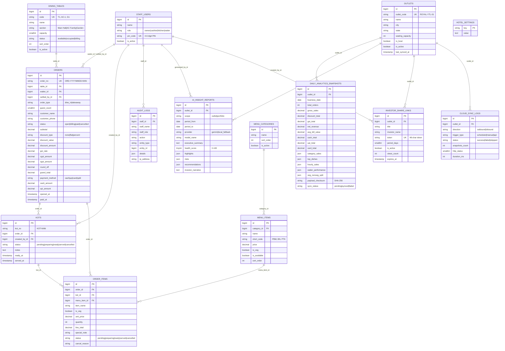

# Database & Data Model Specification (`DATABASE.md`) — Royal Hotel & Restaurant Hybrid POS

## 1. Storage Architecture Overview

Royal Hotel & Restaurant Hybrid POS uses a relational SQL schema compatible with both **MySQL 8.0+ / MariaDB 10.4+** (production XAMPP Local LAN `hotel_pos` and Cloud Hub servers) and **SQLite** (in-memory `:memory:` automated PHPUnit test suite).

All date filtering in `AnalyticsService` and `CloudSyncService` uses database-agnostic `whereDate()` and Eloquent transactions (`DB::transaction()`) so identical business logic executes on MySQL and SQLite.

- **Domain Tables**: 14 tables split across 2 migrations:
  1. **75% Offline POS Core (9 tables)** — [2026_11_20_000001_create_hotel_pos_tables.php](file:///d:/planned%20projects/hotel-pos-laravel/database/migrations/2026_11_20_000001_create_hotel_pos_tables.php)
  2. **25% Cloud AI, Nightly Sync & Investor Portal (5 tables)** — [2026_11_21_211625_create_analytics_and_sync_tables.php](file:///d:/planned%20projects/hotel-pos-laravel/database/migrations/2026_11_21_211625_create_analytics_and_sync_tables.php)
- **Framework Support Tables**: Laravel default migrations for `users`, `sessions`, `cache`, and `jobs`.

---

## 2. Entity-Relationship Diagram (Mermaid)

---

## 3. Detailed Table Schemas

### 3.1 Core Offline POS Tables

#### 1. `staff_users` (`App\Models\StaffUser`)
| Column | Type | Modifiers / Indexes | Description |
|---|---|---|---|
| `id` | `bigint unsigned` | `PK, AUTO_INCREMENT` | Primary identifier |
| `name` | `varchar(100)` | `NOT NULL` | Display name (`Owner (Admin)`, `Waiter Raju`) |
| `role` | `varchar(20)` | `NOT NULL, INDEX` | Role enum: `owner`, `cashier`, `kitchen`, `waiter` |
| `pin_code` | `varchar(10)` | `NOT NULL, UNIQUE` | Fast 4–6 digit login PIN |
| `is_active` | `boolean` | `DEFAULT true` | Instant lockout switch when false |
| `created_at / updated_at` | `timestamp` | `NULLABLE` | Audit timestamps |

#### 2. `dining_tables` (`App\Models\DiningTable`)
| Column | Type | Modifiers / Indexes | Description |
|---|---|---|---|
| `id` | `bigint unsigned` | `PK, AUTO_INCREMENT` | Primary identifier |
| `code` | `varchar(20)` | `NOT NULL, UNIQUE` | Short table code (`T1`–`T8`, `AC-1`–`AC-4`, `G1`–`G2`) |
| `name` | `varchar(60)` | `NOT NULL` | Human label (`Table 1`, `AC Cabin 1`) |
| `section` | `varchar(60)` | `DEFAULT 'Main Hall'` | Floor section grouping (`Main Hall`, `AC Family`, `Garden`) |
| `capacity` | `smallint unsigned` | `DEFAULT 4` | Seat count used to compute outlet seating capacity |
| `status` | `varchar(20)` | `DEFAULT 'available', INDEX` | `available`, `occupied`, `billing` |
| `sort_order` | `int unsigned` | `DEFAULT 0` | Floor display order |
| `is_active` | `boolean` | `DEFAULT true` | Soft visibility flag |

#### 3. `menu_categories` (`App\Models\MenuCategory`)
| Column | Type | Modifiers / Indexes | Description |
|---|---|---|---|
| `id` | `bigint unsigned` | `PK, AUTO_INCREMENT` | Primary identifier |
| `name` | `varchar(80)` | `NOT NULL` | Category title (`Starters`, `Main Course`, `Roti & Naan`, etc.) |
| `sort_order` | `int unsigned` | `DEFAULT 0` | Display sequence |
| `is_active` | `boolean` | `DEFAULT true` | Category active state |

#### 4. `menu_items` (`App\Models\MenuItem`)
| Column | Type | Modifiers / Indexes | Description |
|---|---|---|---|
| `id` | `bigint unsigned` | `PK, AUTO_INCREMENT` | Primary identifier |
| `category_id` | `bigint unsigned` | `FK -> menu_categories.id CASCADE` | Parent category |
| `name` | `varchar(120)` | `NOT NULL` | Dish title (`Paneer Butter Masala`) |
| `short_code` | `varchar(20)` | `NULLABLE, INDEX` | Fast search code (`PBM`, `BN`, `PTK`) |
| `price` | `decimal(10,2)` | `NOT NULL` | Base unit price in INR (`₹`) |
| `is_veg` | `boolean` | `DEFAULT true` | `true` = Veg, `false` = Non-Veg |
| `is_available` | `boolean` | `DEFAULT true` | Real-time kitchen 86 stock availability |
| `sort_order` | `int unsigned` | `DEFAULT 0` | Display sequence |

#### 5. `orders` (`App\Models\Order`)
| Column | Type | Modifiers / Indexes | Description |
|---|---|---|---|
| `id` | `bigint unsigned` | `PK, AUTO_INCREMENT` | Primary identifier |
| `order_no` | `varchar(40)` | `NOT NULL, UNIQUE` | Daily sequential bill ID (`ORD-YYYYMMDD-NNN`) |
| `table_id` | `bigint unsigned` | `NULLABLE, FK -> dining_tables.id NULL ON DELETE` | Linked table (`NULL` for takeaway parcels) |
| `waiter_id` | `bigint unsigned` | `NULLABLE, FK -> staff_users.id NULL ON DELETE` | Staff who opened the order |
| `settled_by_id` | `bigint unsigned` | `NULLABLE, FK -> staff_users.id NULL ON DELETE` | Cashier/Owner who settled the payment |
| `order_type` | `varchar(20)` | `DEFAULT 'dine_in'` | `dine_in` or `takeaway` |
| `guest_count` | `smallint unsigned` | `DEFAULT 2` | Covers count |
| `customer_name` | `varchar(100)` | `NULLABLE` | Optional parcel/table guest name |
| `customer_phone` | `varchar(20)` | `NULLABLE` | Local-only phone (never synced to Cloud/Investor views) |
| `status` | `varchar(20)` | `DEFAULT 'open', INDEX` | `open`, `billing`, `paid`, `cancelled` |
| `subtotal` | `decimal(10,2)` | `DEFAULT 0.00` | Sum of non-cancelled `order_items.line_total` |
| `discount_type` | `varchar(15)` | `DEFAULT 'none'` | `none`, `flat`, `percent` |
| `discount_value` | `decimal(10,2)` | `DEFAULT 0.00` | Raw discount input |
| `discount_amount` | `decimal(10,2)` | `DEFAULT 0.00` | Computed INR discount deducted from subtotal |
| `gst_rate` | `decimal(5,2)` | `DEFAULT 5.00` | Total GST % snapshotted at order creation |
| `cgst_amount` | `decimal(10,2)` | `DEFAULT 0.00` | Half of GST (`taxable * (gst_rate / 200)`) |
| `sgst_amount` | `decimal(10,2)` | `DEFAULT 0.00` | Half of GST (`taxable * (gst_rate / 200)`) |
| `round_off` | `decimal(6,2)` | `DEFAULT 0.00` | Nearest-rupee rounding delta (`-0.49` to `+0.50`) |
| `grand_total` | `decimal(10,2)` | `DEFAULT 0.00` | Final payable rounded INR amount |
| `payment_method` | `varchar(20)` | `NULLABLE` | `cash`, `upi`, `card`, `split` |
| `cash_amount` | `decimal(10,2)` | `DEFAULT 0.00` | Cash portion collected |
| `upi_amount` | `decimal(10,2)` | `DEFAULT 0.00` | UPI portion collected |
| `notes` | `text` | `NULLABLE` | Order-level remarks or cancellation trail |
| `opened_at` | `timestamp` | `NULLABLE` | Order open timestamp |
| `paid_at` | `timestamp` | `NULLABLE, INDEX` | Settlement timestamp (used for daily revenue cutoff) |

#### 6. `kots` (`App\Models\Kot`)
| Column | Type | Modifiers / Indexes | Description |
|---|---|---|---|
| `id` | `bigint unsigned` | `PK, AUTO_INCREMENT` | Primary identifier |
| `kot_no` | `varchar(30)` | `NOT NULL` | Daily sequential ticket ID (`KOT-001`) |
| `order_id` | `bigint unsigned` | `FK -> orders.id CASCADE` | Parent order |
| `created_by_id` | `bigint unsigned` | `NULLABLE, FK -> staff_users.id NULL ON DELETE` | Waiter/Cashier who punched the KOT |
| `status` | `varchar(20)` | `DEFAULT 'pending', INDEX` | `pending`, `preparing`, `ready`, `served`, `cancelled` |
| `notes` | `text` | `NULLABLE` | Ticket-level cooking note |
| `ready_at` | `timestamp` | `NULLABLE` | Timestamp when kitchen marked `ready` |
| `served_at` | `timestamp` | `NULLABLE` | Timestamp when marked `served` or order settled |

#### 7. `order_items` (`App\Models\OrderItem`)
| Column | Type | Modifiers / Indexes | Description |
|---|---|---|---|
| `id` | `bigint unsigned` | `PK, AUTO_INCREMENT` | Primary identifier |
| `order_id` | `bigint unsigned` | `FK -> orders.id CASCADE` | Parent order |
| `kot_id` | `bigint unsigned` | `NULLABLE, FK -> kots.id CASCADE` | Originating KOT |
| `menu_item_id` | `bigint unsigned` | `NULLABLE, FK -> menu_items.id NULL ON DELETE` | Source dish reference |
| `item_name` | `varchar(120)` | `NOT NULL` | Snapshotted dish name at time of order |
| `is_veg` | `boolean` | `DEFAULT true` | Snapshotted Veg/Non-Veg flag |
| `unit_price` | `decimal(10,2)` | `NOT NULL` | Snapshotted unit price in INR |
| `quantity` | `int unsigned` | `DEFAULT 1` | Units ordered |
| `line_total` | `decimal(10,2)` | `NOT NULL` | `round(unit_price * quantity, 2)` |
| `special_note` | `varchar(160)` | `NULLABLE` | Item customization note |
| `status` | `varchar(20)` | `DEFAULT 'pending'` | `pending`, `preparing`, `ready`, `served`, `cancelled` |
| `cancel_reason` | `varchar(160)` | `NULLABLE` | Mandatory anti-theft reason when cancelled |

#### 8. `audit_logs` (`App\Models\AuditLog`)
| Column | Type | Modifiers / Indexes | Description |
|---|---|---|---|
| `id` | `bigint unsigned` | `PK, AUTO_INCREMENT` | Primary identifier |
| `staff_id` | `bigint unsigned` | `NULLABLE, FK -> staff_users.id NULL ON DELETE` | Acting staff reference |
| `staff_name` | `varchar(100)` | `NOT NULL` | Snapshotted staff name (survives staff deletion) |
| `staff_role` | `varchar(20)` | `NOT NULL` | Snapshotted staff role |
| `action` | `varchar(60)` | `NOT NULL, INDEX` | Action key (`staff_login`, `kot_sent`, `item_cancelled`, `discount_applied`, `bill_settled`, `ai_insight_generated`, `cloud_sync_completed`, etc.) |
| `entity_type` | `varchar(40)` | `NULLABLE` | Target entity (`order`, `kot`, `order_item`, `outlet`, etc.) |
| `entity_id` | `bigint unsigned` | `NULLABLE` | Target primary key |
| `details` | `json` | `NULLABLE` | Structured metadata (amounts, reasons, old/new tables) |
| `ip_address` | `varchar(45)` | `NULLABLE` | LAN or WAN client IPv4/IPv6 |

#### 9. `hotel_settings` (`App\Models\HotelSetting`)
| Column | Type | Modifiers / Indexes | Description |
|---|---|---|---|
| `key` | `varchar(60)` | `PRIMARY KEY` | Setting key (`hotel_name`, `gst_rate`, `paper_width`, `pos_mode`, `outlet_code`, `cloud_sync_url`, `cloud_sync_token`, `gemini_api_key`, `gemini_model`, etc.) |
| `value` | `text` | `NULLABLE` | Setting string value |

---

### 3.2 Hybrid 25% Cloud AI, Sync & Investor Tables

#### 10. `outlets` (`App\Models\Outlet`)
- Tracks the local hotel (`is_local = true`) and any remote branches synced into a Cloud Hub (`is_local = false`).
- Unique index on `outlet_code` (e.g., `ROYAL-YTL-01`, `ROYAL-PUN-02`).

#### 11. `daily_analytics_snapshots` (`App\Models\DailyAnalyticsSnapshot`)
- Enforces `UNIQUE (outlet_id, business_date)` for idempotent nightly upserts.
- Stores pre-aggregated financial columns (`gross_sales`, `discount_total`, `gst_total`, `net_revenue`, `avg_bill_value`, `cash_total`, `upi_total`, `card_total`, `cancelled_orders`, `cancelled_items`, `guest_count`) plus 5 structured JSON rollups (`category_sales`, `top_dishes`, `hourly_sales`, `waiter_performance`, `veg_nonveg_split`).
- Tracks sync lifecycle via `payload_checksum` (SHA-256 of data fields), `sync_status` (`pending`, `synced`, `failed`), `synced_at`, `sync_attempts`, and `last_sync_error`.

#### 12. `ai_insight_reports` (`App\Models\AiInsightReport`)
- Stores executive AI reports generated by Google Gemini (`provider = 'gemini'`, `model_name = 'gemini-4-hydrogen'`) or the Offline Statistical Engine (`provider = 'local_fallback'`, `model_name = 'statistical-engine-v1'`).
- Includes `health_score` (`0–100`), `executive_summary`, `highlights` (JSON array), `risks` (JSON array), `recommendations` (JSON array), `investor_narrative`, and `metrics_snapshot` (JSON).

#### 13. `investor_share_links` (`App\Models\InvestorShareLink`)
- Stores tokenized read-only URLs (`/investor/{token}`) with a unique 48-character random `token`, `period_days`, `include_ai_insights`, `include_branch_comparison`, optional `expires_at`, `is_active` revocation toggle, `views_count`, and `last_viewed_at`.

#### 14. `cloud_sync_logs` (`App\Models\CloudSyncLog`)
- Immutable operational log of every outbound upload (`direction = 'outbound'`) and inbound Cloud Hub ingestion (`direction = 'inbound'`), recording `trigger_type` (`scheduled`, `manual`, `api`), `status` (`success`, `failed`, `skipped`), `snapshots_count`, `http_status`, `message`, and `duration_ms`.

---

## 4. Seeding Strategy (`database/seeders/DatabaseSeeder.php`)

Running `php artisan db:seed` idempotently populates:
1. **Default Hotel Settings**: `Royal Family Restaurant & Hotel`, `Main Road, Yavatmal, Maharashtra`, `5%` GST enabled, `80mm` thermal paper width, and default hybrid sync/AI settings via `HotelSetting::allAsMap()`.
2. **5 Default Staff Accounts**:
   - `Owner (Admin)` — Role: `owner`, PIN: `1111`
   - `Cashier Desk` — Role: `cashier`, PIN: `2222`
   - `Main Kitchen` — Role: `kitchen`, PIN: `3333`
   - `Waiter Raju` — Role: `waiter`, PIN: `4444`
   - `Waiter Amit` — Role: `waiter`, PIN: `5555`
3. **14 Dining Tables across 3 Sections**:
   - `Main Hall`: `T1`–`T8` (capacities 2–6)
   - `AC Family`: `AC-1`–`AC-4` (capacities 6–8)
   - `Garden`: `G1`–`G2` (capacity 6)
4. **6 Menu Categories & 29 Indian Dishes with Short Codes**:
   - `Starters` (6 dishes: `PTK`, `VCR`, `HBK`, `MP`, `CTH`, `CLP`)
   - `Main Course` (7 dishes: `PBM`, `KJC`, `DT`, `DF`, `MVK`, `BC`, `MSJ`)
   - `Roti & Naan` (5 dishes: `TR`, `BR`, `BN`, `GN`, `TC`)
   - `Rice & Biryani` (4 dishes: `JR`, `VBR`, `CBR`, `DK`)
   - `Chinese` (3 dishes: `VHN`, `VMD`, `PC`)
   - `Beverages & Desserts` (4 dishes: `MW`, `MC`, `CD`, `GJ`)

---

## 5. Data Retention & Backup Policy

1. **One-Click JSON Full Snapshot (`POST /owner/backup`)**: Streams a timestamped `hotel_pos_backup_YYYY-MM-DD_HHMMSS.json` file containing settings, staff, tables, categories, menu items, orders, KOTs, order items, and the latest 1,000 audit logs, while recording a `backup_downloaded` entry in `audit_logs`.
2. **UTF-8 BOM Excel CSV Sales Export (`GET /owner/export-sales`)**: Exports settled bills for any date range for accountant/GST filing archival.
3. **Nightly Offsite Cloud Replication (`01:00 AM`)**: Daily aggregated financial snapshots (`daily_analytics_snapshots`) are replicated to the central Cloud Hub so historical financial performance survives even if local counter hardware fails.
4. **Immutability Rule**: Settled orders (`status = 'paid'`), cancelled line items (`status = 'cancelled'`), and `audit_logs` are never hard-deleted from the UI.
