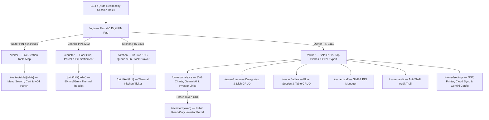

# Design System & UI/UX Specification (`DESIGN.md`) — Royal Hotel & Restaurant Hybrid POS

## 1. Design Philosophy & Operational Context

**Royal Hotel & Restaurant Hybrid POS** is engineered for high-pressure Indian hospitality environments: dim or bright dining halls, steam-heavy commercial kitchens, fast counter cashiers, and executive investor boardrooms.

- **100% Offline Zero-CDN Rendering**: All stylesheets ([public/css/pos.css](file:///d:/planned%20projects/hotel-pos-laravel/public/css/pos.css)), vector icons ([public/icons/pos-icon.svg](file:///d:/planned%20projects/hotel-pos-laravel/public/icons/pos-icon.svg)), and interactive SVG charts ([public/js/pos-charts.js](file:///d:/planned%20projects/hotel-pos-laravel/public/js/pos-charts.js)) are self-hosted and render with zero external font or JavaScript CDN dependencies.
- **Role-Optimized Density**:
  - **Waiter Mobile UI**: Large thumb-friendly tap targets (`min-height: 44px`), sticky bottom cart bar, instant short-code search (`PBM`, `BN`), and color-coded table status cards.
  - **Kitchen Display System (KDS)**: High-contrast ticket cards visible from 2–3 meters away, elapsed-minute badges, audio chime alerts, and one-tap status progression (`Start Cooking` → `Mark Ready` → `Served`).
  - **Counter Billing Workspace**: Two-column split screen (live floor/parcel grid on left, active invoice & settlement workspace on right) for sub-10-second bill settlement.
  - **Owner & Investor Dashboards**: Executive KPI cards, interactive SVG area/bar/donut charts, AI health score gauges, and clean `@media print` stylesheets for 80mm/58mm thermal receipts and A4 Investor PDFs.

---

## 2. Information Architecture & Screen Hierarchy

---

## 3. Design Tokens (`public/css/pos.css`)

### 3.1 Color Palette

| Token | Hex / Value | Semantic Usage |
|---|---|---|
| `--bg` | `#f3f4f6` | App canvas background (low glare during long shifts) |
| `--surface` | `#ffffff` | Primary card, table tile, and modal background |
| `--surface-alt` | `#f8fafc` | Secondary table rows, metric boxes, and filter bars |
| `--nav-bg` | `#111827` | Sticky top navigation header |
| `--border` | `#e2e8f0` | Default card and table hairlines |
| `--border-strong` | `#cbd5e1` | Form input borders and dividers |
| `--text` | `#0f172a` | Primary headings, dish names, and INR amounts |
| `--text-sec` | `#475569` | Secondary labels and table metadata |
| `--text-muted` | `#64748b` | Timestamps, helper captions, and empty states |
| `--brand` | `#ea580c` | Primary hospitality saffron-orange CTA & active nav state |
| `--brand-hover` | `#c2410c` | Hover/active state for primary buttons |
| `--emerald` | `#059669` | Available table, Veg indicator, Cash payment, Ready KOT, Synced status |
| `--amber` | `#d97706` | Occupied table, Preparing KOT, Pending sync warning |
| `--blue` | `#2563eb` | UPI / Digital payment, Billing requested state, Cloud Hub badge |
| `--rose` | `#dc2626` | Non-Veg indicator, Cancelled item/order, Out-of-Stock (86), Revoked link |
| `--purple` | `#7c3aed` | Card payment, Gemini AI insight accent, Portfolio benchmark badge |

### 3.2 Typography & Numerics

- **UI Font Stack (`--font`)**: `system-ui, -apple-system, "Segoe UI", Roboto, "Helvetica Neue", Arial, sans-serif` — renders natively on Windows 10/11, Android, and iOS without webfont latency.
- **Monospace Stack (`--mono`)**: `ui-monospace, SFMono-Regular, Menlo, Consolas, monospace` with `font-variant-numeric: tabular-nums` applied via `.mono` on all INR currency figures (`₹1,24,500`), order numbers (`ORD-20261122-001`), KOT numbers (`KOT-001`), timers, and PIN inputs.

### 3.3 Spacing, Radii & Elevation

- **Border Radii**: `--radius: 12px` for standard cards/inputs; `--radius-lg: 16px` for hero panels and modals.
- **Shadows**:
  - `--shadow-sm`: `0 1px 3px rgba(15, 23, 42, 0.06)`
  - `--shadow-md`: `0 8px 24px rgba(15, 23, 42, 0.09)`
- **Grid Layouts**: Responsive CSS Grid utilities (`.grid-2`, `.grid-3`, `.grid-4`, `.kpi-grid`, `.table-grid`) that collapse gracefully on tablet (`<= 1024px`) and mobile (`<= 640px`) breakpoints.

---

## 4. Screen & Component Specifications

### 4.1 Global Navigation Shell (`resources/views/layouts/pos.blade.php`)
- Sticky dark header (`.pos-nav`) displaying hotel brand name, role-gated navigation pills (`Waiter Floor`, `Kitchen KDS`, `Billing Counter`, `Owner Dashboard`, `AI Charts & Investor`, `Menu`, `Tables`, `Staff`, `Audit Log`, `Settings`), active staff role badge (`.staff-chip`), and one-tap `Logout`.
- Flash notification banners for `session('status')` (emerald) and `session('error')` / validation errors (rose).

### 4.2 Fast Staff PIN Login (`resources/views/auth/login.blade.php`)
- Interactive numeric keypad (`0–9`, `Clear`, `Enter`) + keyboard input support.
- One-tap quick-fill demo role pills in local/demo environments so evaluators can test Owner (`1111`), Cashier (`2222`), Kitchen (`3333`), and Waiter (`4444`/`5555`) flows immediately.

### 4.3 Waiter Mobile Floor & Table Ordering (`resources/views/waiter/`)
- **Floor Map (`waiter/index.blade.php`)**: Grouped by section (`Main Hall`, `AC Family`, `Garden`). Each table tile displays table code (`T1`), capacity, status badge (`Available` emerald, `Occupied` amber, `Billing` blue), live running total in INR, elapsed minutes, and a pulsing badge when the kitchen marks a KOT `READY`. Auto-refreshes every 6 seconds via `GET /api/waiter/tables`.
- **Table Order Screen (`waiter/table.blade.php`)**:
  - Instant client-side search filtering dishes by name (`Paneer Butter Masala`) or short code (`PBM`, `BN`).
  - Category filter pills + Veg (green dot-in-square) / Non-Veg (red dot-in-square) Indian FSSAI standard icons.
  - Interactive cart builder with `+ / -` quantity steppers, per-item special notes (`less spicy`, `no onion`), guest count input, and sticky `Send KOT to Kitchen` + `Request Bill` actions.

### 4.4 Live Kitchen Display System (`resources/views/kitchen/index.blade.php`)
- 3-second AJAX polling against `GET /api/kitchen/live` with Web Audio API chime notification whenever `latest_kot_id` increases.
- Status counters in header (`Pending`, `Preparing`, `Ready`).
- Ticket cards color-coded by urgency and status, showing table/parcel badge, waiter name, elapsed minutes, special instructions, and one-tap progression buttons (`Start Cooking`, `Mark Ready`, `Mark Served`, `Print KOT`).
- Collapsible **86 Stock Availability Drawer** allowing the chef to toggle any dish `IN STOCK` / `OUT OF STOCK` in one tap.

### 4.5 Counter Billing Workspace (`resources/views/counter/index.blade.php`)
- **Left Pane**: Live table grid, active Takeaway Parcel list, `+ New Parcel Order` form, and today's last 15 settled bills with one-click receipt reprint.
- **Right Pane (Selected Order Invoice)**:
  - Line-item breakdown with KOT origin badges and inline `Cancel Item` (requires mandatory anti-theft reason).
  - Quick-add dish bar for counter additions.
  - Discount drawer supporting `None`, `Flat (₹)`, or `Percent (%)` with audit reason.
  - Table Transfer selector (`Move to empty table`).
  - Tax summary showing Subtotal, Discount, CGST, SGST, Round-Off, and bold Grand Total.
  - Settlement form supporting `Cash`, `UPI`, `Card`, and `Split (Cash + UPI)` with auto-calculated balance and automatic thermal bill launch on settlement.

### 4.6 Thermal Receipt Layouts (`resources/views/print/bill.blade.php` & `kot.blade.php`)
- Configurable width (`80mm` default or `58mm` compact) read from `hotel_settings.paper_width`.
- High-contrast monochrome layout using dashed dividers, consolidated duplicate items on customer bills, GSTIN & CGST/SGST breakdown, payment mode details, and `@media print` rules that hide screen buttons (`Print`, `Close`) during physical thermal printing.

### 4.7 Offline Interactive SVG Chart Engine (`public/js/pos-charts.js`)
Used on both `/owner/analytics` and `/investor/{token}`:
1. **`PosCharts.renderRevenueTrend(container, dailyTrend)`**: Responsive SVG dual-layer Area + Bar chart plotting daily Net Revenue (`₹`) and bill volume across the selected window, complete with gridlines, peak callouts, and hover tooltips.
2. **`PosCharts.renderDonut(container, slices, options)`**: SVG arc donut/pie chart with center total metric and percentage legend table (used for **Payment Mode Split** and **Menu Category Mix**).
3. **`PosCharts.renderHourlyBars(container, hourlySales)`**: Vertical bar chart highlighting peak dining hours in saffron-orange (`#ea580c`) and standard hours in slate-blue.
4. **`PosCharts.renderHorizontalBars(container, items, options)`**: Horizontal progress bars comparing **Top Revenue Dishes** and **Multi-Outlet Branch Performance**.

---

## 5. Responsiveness, Accessibility & Print Standards

- **Breakpoints**:
  - Desktop Counter & Owner Analytics (`>= 1025px`): Multi-column workspace and 2x2 chart grids.
  - Kitchen Tablet (`641px – 1024px`): 2-column KDS ticket grid and touch-sized controls.
  - Waiter Smartphone (`<= 640px`): Single-column stacked cards, horizontal scrolling category pills, sticky bottom KOT submission bar.
- **Accessibility**:
  - Semantic HTML5 landmarks (`<nav>`, `<main>`, `<section>`, `<table>`), explicit `<label>` associations, high contrast ratios (`> 7:1` on primary text), and dual encoding (color + text/icon badge) for Veg/Non-Veg and table statuses.
- **Investor PDF Print Mode**:
  - `@media print` rules in `resources/views/investor/report.blade.php` strip interactive chrome, force clean page breaks around SVG charts and branch tables, and preserve crisp vector chart rendering when saving to PDF.
