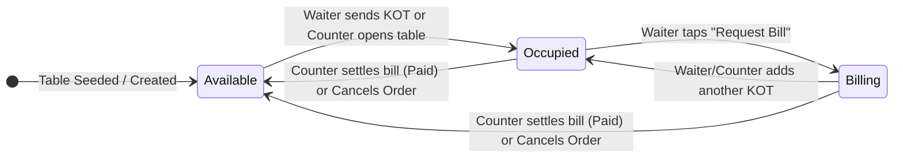
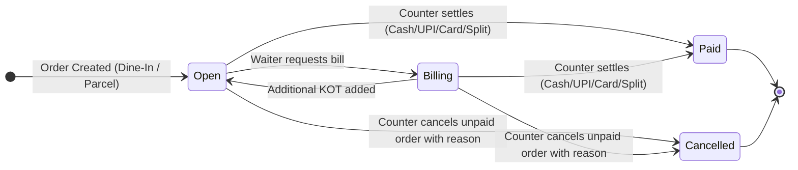
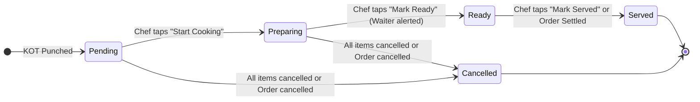
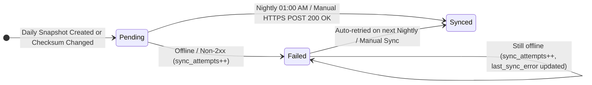

# Feature Development Specification (`FEATURES.md`) — Royal Hotel & Restaurant Hybrid POS

## 1. Feature Catalog Overview

Royal Hotel & Restaurant Hybrid POS delivers **9 core functional modules** divided across the **75% Offline LAN Floor Core** (Features F1–F5) and the **25% Cloud AI, Nightly Sync & Investor Layer** (Features F6–F9).

---

## 2. State Transition Diagrams

### 2.1 Dining Table, Order & KOT Lifecycles

### 2.2 Nightly Cloud Snapshot Sync Lifecycle

---

## 3. Detailed Feature Specifications

### F1. Fast PIN Authentication & Role-Based Access Control
- **User Story**: As a busy waiter, chef, cashier, or owner, I want to log in with a 4–6 digit numeric PIN in under 2 seconds and land directly on my workspace without typing email addresses or passwords.
- **Business Rules**:
  - `StaffUser::canAccess()` grants `owner` universal access to all screens while restricting `waiter` to Waiter/Print routes, `kitchen` to Kitchen/Print routes, and `cashier` to Counter/Waiter/Kitchen/Print routes.
  - Setting `is_active = false` on any staff member in **Owner → Staff** locks out their session on the very next request (`EnsureStaffAuthenticated`).
  - Every login writes a `staff_login` entry to `audit_logs` with IP and role.
- **Acceptance Criteria**:
  - Entering `4444` redirects to `/waiter`; `3333` to `/kitchen`; `2222` to `/counter`; `1111` to `/owner`.
  - A logged-in waiter attempting to visit `/owner` or `/counter` is redirected back to `/waiter` with an error flash message.

### F2. Waiter Mobile Floor Map & Short-Code KOT Ordering
- **User Story**: As a waiter walking the dining floor with a smartphone on local Wi-Fi, I want to see which tables are available/occupied/billing, search dishes by short code (`PBM`, `BN`), and send KOTs straight to the kitchen.
- **Business Rules**:
  - Floor map groups active tables by `section` (`Main Hall`, `AC Family`, `Garden`) and polls `GET /api/waiter/tables` every 6 seconds.
  - Multiple incremental KOTs can be sent to the same open table order (`KOT-001`, `KOT-002`, etc.).
  - If a table is in `billing` status and the guest orders dessert, sending a new KOT automatically transitions the order and table back to `open` / `occupied` and recalculates totals.
  - Dishes marked `is_available = false` (86'd by kitchen) cannot be added to new carts.
- **Acceptance Criteria**:
  - Searching `PBM` filters immediately to `Paneer Butter Masala`.
  - Submitting a cart creates a `kots` record, `order_items` records with snapshotted `item_name` and `unit_price`, recalculates order totals, and logs `kot_sent`.

### F3. Live Kitchen Display System (KDS) & 86 Stock Control
- **User Story**: As a head chef, I want new KOTs to pop up on the kitchen screen within 3 seconds with an audio chime so no paper slip is lost, and I want to mark dishes out-of-stock when ingredients run out.
- **Business Rules**:
  - `GET /api/kitchen/live` returns active KOTs ordered by priority (`pending` → `preparing` → `ready`) and creation order.
  - When `latest_kot_id` increases on the client, Web Audio API plays an alert chime.
  - Transitioning a KOT to `ready` stamps `ready_at = now()` and illuminates a green `READY` badge on the Waiter's floor card.
  - Toggling dish availability (`PATCH /kitchen/menu/{item}/toggle`) immediately updates `is_available` and logs `menu_stock_toggled`.
- **Acceptance Criteria**:
  - Cancelled items are automatically excluded from the KDS item list.
  - Chef can print a physical thermal KOT slip (`GET /print/kot/{kot}`) at any time.

### F4. Counter Billing, GST Math, Discounts, Table Transfer & Split Settlement
- **User Story**: As a cashier, I want to manage dine-in tables and takeaway parcels, transfer tables, apply authorized discounts, cancel mistyped items with a mandatory reason, and settle bills via Cash, UPI, Card, or Split payment with an instant 80mm/58mm thermal receipt.
- **Business Logic & Tax Math (`PosService::recalculateOrder`)**:
  - $\text{Subtotal} = \sum (\text{non-cancelled } \text{line\_total})$
  - $\text{Discount Amount} = \min(\text{Subtotal}, \text{discount\_value})$ for `flat`, or $\text{round}(\text{Subtotal} \times \frac{\text{discount\_value}}{100}, 2)$ for `percent`.
  - $\text{Taxable Amount} = \max(0, \text{Subtotal} - \text{Discount Amount})$
  - $\text{CGST} = \text{round}(\text{Taxable Amount} \times \frac{\text{gst\_rate} / 2}{100}, 2)$
  - $\text{SGST} = \text{round}(\text{Taxable Amount} \times \frac{\text{gst\_rate} / 2}{100}, 2)$
  - $\text{Raw Total} = \text{Taxable Amount} + \text{CGST} + \text{SGST}$
  - $\text{Grand Total} = \text{round}(\text{Raw Total}, 0)$ (nearest whole rupee; `round_off = Grand Total - Raw Total`).
- **Split Payment Math (`PosService::settleOrder`)**:
  - `cash`: `cash_amount = grand_total`, `upi_amount = 0`
  - `upi`: `upi_amount = grand_total`, `cash_amount = 0`
  - `card`: `cash_amount = 0`, `upi_amount = 0`, `payment_method = 'card'`
  - `split`: `cash_amount = input_cash`, `upi_amount = input_upi > 0 ? input_upi : max(0, grand_total - cash_amount)`
- **Acceptance Criteria**:
  - Cancelling an item requires a non-empty `reason`; if all items on a KOT are cancelled, the parent KOT is automatically marked `cancelled`.
  - Transferring an order moves `table_id` to an unoccupied target table, sets the old table to `available`, and sets the target table to `occupied`/`billing`.
  - Settling an order marks all remaining open KOTs/items `served`, releases the table to `available`, logs `bill_settled`, and triggers the thermal bill print view.

### F5. Owner Administration, Anti-Theft Audit Trail, CSV Export & JSON Backup
- **User Story**: As a hotel owner, I want full control over my menu prices, tables, staff PINs, GST settings, Excel sales exports, database backups, and an uneditable audit log of every cancellation and discount.
- **Business Rules**:
  - `GET /owner/export-sales` outputs a UTF-8 BOM (`\xEF\xBB\xBF`) CSV stream so Microsoft Excel renders `₹` and Indian names cleanly.
  - `GET /owner/tables` blocks deletion of any table that currently has an open or billing order.
  - `GET /owner/audit` records 15+ distinct action types with staff name, role, IP address, timestamp, and JSON details.
- **Acceptance Criteria**:
  - Owner can filter audit logs by action type (`item_cancelled`, `discount_applied`, `order_cancelled`, `table_transferred`, etc.).
  - Downloading a backup streams a complete `.json` snapshot and logs `backup_downloaded`.

### F6. Offline-Capable Interactive SVG Analytics & Multi-Outlet Benchmarking (`/owner/analytics`)
- **User Story**: As an owner or multi-branch operator, I want visual graphs and pie charts of my revenue trends, payment modes, menu categories, peak hours, and branch comparisons that work even when the hotel's internet is down.
- **Business Rules**:
  - `AnalyticsService::buildDailySnapshot()` aggregates each day's settled and cancelled orders into `daily_analytics_snapshots` and computes a SHA-256 `payload_checksum`.
  - If a new bill is settled later that same day, the checksum changes and `sync_status` automatically resets to `pending` so the updated day re-syncs at night.
  - Period-over-period growth % compares the selected date window against the immediately preceding equal-length window.
  - Annualized Run Rate (ARR) is calculated as $(\text{Net Revenue} \div \text{Active Selling Days}) \times 365$.
- **Acceptance Criteria**:
  - All 6 interactive SVG charts render via `public/js/pos-charts.js` with zero external CDN requests.

### F7. Google Gemini AI Executive Insights & Offline Statistical Fallback
- **User Story**: As an owner preparing for growth or investor meetings, I want an AI CFO analyst to review my POS telemetry and give me a 0–100 Health Score, Executive Summary, Leakage Risks, Margin Recommendations, and Investor Narrative.
- **Business Rules**:
  - When `gemini_api_key` is configured, `GeminiAnalyticsService` calls `POST https://generativelanguage.googleapis.com/v1/interactions` (`model: gemini-4-hydrogen`) with a strict JSON Schema `response_format`.
  - If no API key is configured, the hotel is offline, or the API returns a non-2xx/timeout error, `GeminiAnalyticsService::buildStatisticalFallback()` deterministically computes the Health Score and structured insights so the feature never fails.
  - Zero customer PII (no customer phone numbers or names) is ever sent to Gemini.
- **Acceptance Criteria**:
  - Clicking **Generate AI Executive Insights** stores an `AiInsightReport` record, logs `ai_insight_generated`, and displays the provider badge (`Google Gemini` or `Offline Statistical Engine`).

### F8. Dual-Mode Nightly Cloud Sync (`01:00 AM` Outlet → Cloud Hub)
- **User Story**: As a multi-branch hotel owner, I want each local hotel POS to work offline during the day and automatically upload its daily snapshot to my live cloud server every night at 1:00 AM.
- **Business Rules**:
  - Outbound sync (`CloudSyncService::syncOutbound`) selects all snapshots where `sync_status IN ('pending', 'failed')` or `business_date = today()`, signs the JSON body with `HMAC-SHA256(timestamp + "." + rawBody, token)`, and sends `POST {cloud_sync_url}`.
  - If the hotel's internet is down at 1:00 AM, snapshots are marked `sync_status = 'failed'`, `sync_attempts` is incremented, `last_sync_error` is recorded, and they are automatically retried on the next sync.
  - Inbound Cloud Hub (`POST /api/cloud/sync`) verifies the Bearer token and HMAC signature in constant time (`hash_equals`) and upserts the remote `Outlet` and `DailyAnalyticsSnapshot` rows inside a DB transaction.
- **Acceptance Criteria**:
  - Running `php artisan pos:sync-cloud --days=7 --ai` syncs pending days, logs a `CloudSyncLog` entry, and updates `/api/cloud/health`.

### F9. Tokenized Read-Only Investor Performance Portal (`/investor/{token}`)
- **User Story**: As a founder raising capital or applying for a bank expansion loan, I want to share a live, verifiable read-only performance link with an investor and revoke it anytime.
- **Business Rules**:
  - Each link uses a unique 48-character cryptographic random token (`Str::random(48)`).
  - Supports configurable lookback window (`7` to `365` days), optional expiration (`expires_at`), branch scope (`All Outlets` or single branch), and toggles for AI Insights and Branch Comparison.
  - Every investor visit increments `views_count` and updates `last_viewed_at`.
  - Revoked or expired links return HTTP `404` (`resources/views/investor/unavailable.blade.php`).
- **Acceptance Criteria**:
  - Unauthenticated investor can open `/investor/{token}`, inspect all SVG charts and AI narrative, and click **Print / Save Investor PDF** without seeing any staff PINs, navigation links, or customer phone numbers.
