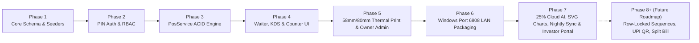

# Project Implementation Plan (`IMPLEMENTATION.md`) — Royal Hotel & Restaurant Hybrid POS

## 1. Delivery Approach & Architecture Evolution

The platform was engineered in **7 completed vertical milestones**, first establishing a 100% offline-resilient LAN POS core (Phases 1–6) and then extending it into a **75% Offline / 25% Cloud AI Hybrid Platform** with interactive offline SVG charts, nightly signed cloud sync, dual-mode Cloud Hub multi-branch benchmarking, Google Gemini AI executive insights, and tokenized Investor Share Portals (Phase 7).

---

## 2. Completed Milestones & Deliverables

### Phase 1 — Core POS Database Schema & Realistic Indian Seeder *(Completed)*
- [x] Created migration [2026_11_20_000001_create_hotel_pos_tables.php](file:///d:/planned%20projects/hotel-pos-laravel/database/migrations/2026_11_20_000001_create_hotel_pos_tables.php) defining 9 core tables (`staff_users`, `dining_tables`, `menu_categories`, `menu_items`, `orders`, `kots`, `order_items`, `audit_logs`, `hotel_settings`).
- [x] Built [DatabaseSeeder.php](file:///d:/planned%20projects/hotel-pos-laravel/database/seeders/DatabaseSeeder.php) seeding default settings, 5 role PINs (`1111`–`5555`), 14 dining tables across 3 sections (`Main Hall`, `AC Family`, `Garden`), 6 categories, and 29 Indian restaurant dishes with short codes (`PBM`, `BN`, `PTK`, etc.).

### Phase 2 — Fast Staff PIN Authentication & Role-Based Access Control *(Completed)*
- [x] Implemented [AuthPinController.php](file:///d:/planned%20projects/hotel-pos-laravel/app/Http/Controllers/AuthPinController.php) and [EnsureStaffAuthenticated.php](file:///d:/planned%20projects/hotel-pos-laravel/app/Http/Middleware/EnsureStaffAuthenticated.php) (`pos.auth`).
- [x] Built touch-friendly numeric PIN pad login ([resources/views/auth/login.blade.php](file:///d:/planned%20projects/hotel-pos-laravel/resources/views/auth/login.blade.php)) with role-based landing redirect (`StaffUser::homeRoute()`).

### Phase 3 — Transactional POS & Anti-Theft Engine *(Completed)*
- [x] Built [PosService.php](file:///d:/planned%20projects/hotel-pos-laravel/app/Services/PosService.php) with `DB::transaction()` across table opening, parcel creation, incremental KOTs, item/order cancellation with mandatory reasons, flat/% discounts, table transfers, CGST/SGST + nearest-rupee rounding, Cash/UPI/Card/Split settlement, Indian currency formatting (`formatINR`), and immutable `audit_logs`.

### Phase 4 — Waiter Mobile POS, 3s Kitchen KDS & Counter Billing UI *(Completed)*
- [x] Built [WaiterController.php](file:///d:/planned%20projects/hotel-pos-laravel/app/Http/Controllers/WaiterController.php) + views (`waiter/index.blade.php`, `waiter/table.blade.php`) with 6s live floor polling and short-code menu search.
- [x] Built [KitchenController.php](file:///d:/planned%20projects/hotel-pos-laravel/app/Http/Controllers/KitchenController.php) + view (`kitchen/index.blade.php`) with 3s `/api/kitchen/live` polling, Web Audio chime alerts, elapsed-minute badges, and 86 dish stock drawer.
- [x] Built [CounterController.php](file:///d:/planned%20projects/hotel-pos-laravel/app/Http/Controllers/CounterController.php) + view (`counter/index.blade.php`) supporting dine-in, takeaway parcels, discounts, transfers, cancellations, and split settlements.

### Phase 5 — 80mm/58mm Thermal Printing & Owner Master Controls *(Completed)*
- [x] Built [resources/views/print/bill.blade.php](file:///d:/planned%20projects/hotel-pos-laravel/resources/views/print/bill.blade.php) and [resources/views/print/kot.blade.php](file:///d:/planned%20projects/hotel-pos-laravel/resources/views/print/kot.blade.php) with configurable `80mm`/`58mm` widths and consolidated line items.
- [x] Built [OwnerController.php](file:///d:/planned%20projects/hotel-pos-laravel/app/Http/Controllers/OwnerController.php) + views (`owner/dashboard`, `menu`, `tables`, `staff`, `audit`, `settings`) with UTF-8 BOM CSV export and full JSON database backup.

### Phase 6 — Windows XAMPP Apache Port `6808` Packaging *(Completed)*
- [x] Created [Activate-Hotel-POS-6808.bat](file:///d:/planned%20projects/hotel-pos-laravel/Activate-Hotel-POS-6808.bat), [Open-Hotel-POS-App.vbs](file:///d:/planned%20projects/hotel-pos-laravel/Open-Hotel-POS-App.vbs), [Create-Hotel-POS-Shortcut.bat](file:///d:/planned%20projects/hotel-pos-laravel/Create-Hotel-POS-Shortcut.bat), and PWA [public/manifest.json](file:///d:/planned%20projects/hotel-pos-laravel/public/manifest.json).

### Phase 7 — 25% Cloud AI Analytics, Nightly Sync & Investor Portal *(Completed)*
- [x] Created migration [2026_11_21_211625_create_analytics_and_sync_tables.php](file:///d:/planned%20projects/hotel-pos-laravel/database/migrations/2026_11_21_211625_create_analytics_and_sync_tables.php) (`outlets`, `daily_analytics_snapshots`, `ai_insight_reports`, `investor_share_links`, `cloud_sync_logs`) and [config/pos.php](file:///d:/planned%20projects/hotel-pos-laravel/config/pos.php).
- [x] Built zero-CDN SVG chart library [public/js/pos-charts.js](file:///d:/planned%20projects/hotel-pos-laravel/public/js/pos-charts.js) and aggregation engine [AnalyticsService.php](file:///d:/planned%20projects/hotel-pos-laravel/app/Services/AnalyticsService.php).
- [x] Built [GeminiAnalyticsService.php](file:///d:/planned%20projects/hotel-pos-laravel/app/Services/GeminiAnalyticsService.php) integrating Google Gemini Interactions API v1 (`gemini-4-hydrogen`) with automatic Offline Statistical Engine fallback.
- [x] Built [CloudSyncService.php](file:///d:/planned%20projects/hotel-pos-laravel/app/Services/CloudSyncService.php), [SyncPosCloudCommand.php](file:///d:/planned%20projects/hotel-pos-laravel/app/Console/Commands/SyncPosCloudCommand.php), [CloudSyncApiController.php](file:///d:/planned%20projects/hotel-pos-laravel/app/Http/Controllers/CloudSyncApiController.php), and [Setup-Nightly-Cloud-Sync.bat](file:///d:/planned%20projects/hotel-pos-laravel/Setup-Nightly-Cloud-Sync.bat).
- [x] Built [InvestorPortalController.php](file:///d:/planned%20projects/hotel-pos-laravel/app/Http/Controllers/InvestorPortalController.php) and views (`investor/report.blade.php`, `investor/unavailable.blade.php`).
- [x] Verified with 139 assertions across [HotelPosFlowTest.php](file:///d:/planned%20projects/hotel-pos-laravel/tests/Feature/HotelPosFlowTest.php) and [HybridAnalyticsAndSyncTest.php](file:///d:/planned%20projects/hotel-pos-laravel/tests/Feature/HybridAnalyticsAndSyncTest.php), plus Pitch Deck PDF & HTML in `pitch/`.

---

## 3. Future Roadmap (Phase 8+)

| Priority | Planned Feature | Technical Implementation Plan |
|---|---|---|
| **P1** | Concurrency-safe `order_no` & `kot_no` sequences | Use `lockForUpdate()` on a daily counter row inside `PosService` transaction to prevent duplicate order numbers under simultaneous waiter submissions. |
| **P1** | Login PIN rate limiting & hashing | Apply `throttle:10,1` middleware to `POST /login` and migrate `staff_users.pin_code` to HMAC/salted hash verification. |
| **P2** | Dynamic UPI QR code on thermal bills | Render an inline offline SVG QR code from `upi://pay?pa=<upi_id>&pn=<hotel_name>&am=<grand_total>&cu=INR` on `resources/views/print/bill.blade.php`. |
| **P2** | Per-outlet secret keys in Cloud Hub UI | Add a Cloud Hub Outlet Provisioning panel utilizing `outlets.sync_secret_hash` so franchisee branches can authenticate with individual tokens. |
| **P2** | Guided JSON backup restore utility | Add an Owner-only restore upload action that validates JSON backup schema structure inside a transaction. |
| **P3** | Split-bill & table-merge workflows | Allow splitting an open table by seat/items into multiple invoices or merging two occupied family tables. |

---

## 4. Component & File Ownership Map

| Subsystem | Primary Files |
|---|---|
| **Authentication & RBAC** | `app/Http/Controllers/AuthPinController.php`, `app/Http/Middleware/EnsureStaffAuthenticated.php`, `app/Models/StaffUser.php`, `resources/views/auth/login.blade.php` |
| **Core POS Engine** | `app/Services/PosService.php`, `app/Models/{DiningTable,MenuCategory,MenuItem,Order,Kot,OrderItem,AuditLog,HotelSetting}.php` |
| **Floor, Kitchen & Counter UIs** | `app/Http/Controllers/{Waiter,Kitchen,Counter,Owner}Controller.php`, `resources/views/{waiter,kitchen,counter,owner,print}/` |
| **Hybrid Analytics & SVG Charts** | `app/Services/AnalyticsService.php`, `app/Http/Controllers/AnalyticsController.php`, `public/js/pos-charts.js`, `resources/views/owner/analytics.blade.php` |
| **Google Gemini AI & Fallback** | `app/Services/GeminiAnalyticsService.php`, `app/Models/AiInsightReport.php` |
| **Nightly Cloud Sync & Hub API** | `app/Services/CloudSyncService.php`, `app/Console/Commands/SyncPosCloudCommand.php`, `app/Http/Controllers/CloudSyncApiController.php`, `routes/api.php`, `routes/console.php`, `Setup-Nightly-Cloud-Sync.bat` |
| **Investor Executive Portal** | `app/Http/Controllers/InvestorPortalController.php`, `app/Models/InvestorShareLink.php`, `resources/views/investor/{report,unavailable}.blade.php` |
| **15-File Documentation & Pitch** | `README.md`, `AGENTS.md`, `docs/*.md`, `pitch/Royal_Hotel_LAN_POS_Pitch_Deck.pdf`, `pitch/pitch-deck.html` |
