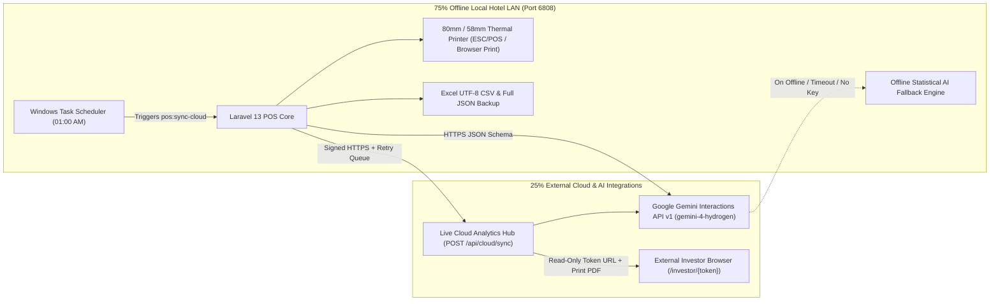

# External Integrations Guide (`INTEGRATIONS.md`) — Royal Hotel & Restaurant Hybrid POS

## 1. Integrations Overview

Royal Hotel & Restaurant Hybrid POS is intentionally designed so **75% of restaurant floor operations have zero hard runtime dependencies on external cloud services**, while the **25% Cloud AI & Nightly Sync layer** integrates cleanly with external services using resilient timeouts, HMAC signatures, and deterministic offline fallbacks.



---

## 2. Google Gemini Interactions API (`v1`)

### 2.1 Service Implementation
- **Class**: [app/Services/GeminiAnalyticsService.php](file:///d:/planned%20projects/hotel-pos-laravel/app/Services/GeminiAnalyticsService.php)
- **Endpoint**: `POST https://generativelanguage.googleapis.com/v1/interactions`
- **Default Model**: `gemini-4-hydrogen`
- **Authentication Header**: `x-goog-api-key: <GEMINI_API_KEY>`
- **Configuration Keys** (`config/pos.php` & `hotel_settings` table):
  - `GEMINI_API_KEY` / `hotel_settings.gemini_api_key`
  - `GEMINI_MODEL` / `hotel_settings.gemini_model` (default `gemini-4-hydrogen`)
  - `GEMINI_API_ENDPOINT` (`https://generativelanguage.googleapis.com/v1/interactions`)
  - `GEMINI_TIMEOUT` (`25` seconds)

### 2.2 Request & Structured Output Schema
`GeminiAnalyticsService::callGeminiInteractionsApi()` sends compact, zero-PII aggregated financial telemetry (`period`, `kpis`, `payment_split`, `top_categories`, `top_dishes`, `veg_nonveg`, `outlet_comparison`) and enforces a strict JSON Schema via `response_format`:

```json
{
  "model": "gemini-4-hydrogen",
  "input": "You are a hospitality CFO and restaurant operations analyst reviewing verified Indian hotel POS telemetry...",
  "response_format": {
    "type": "text",
    "mime_type": "application/json",
    "schema": {
      "type": "object",
      "properties": {
        "executive_summary": { "type": "string" },
        "health_score": { "type": "integer" },
        "highlights": { "type": "array", "items": { "type": "string" } },
        "risks": { "type": "array", "items": { "type": "string" } },
        "recommendations": { "type": "array", "items": { "type": "string" } },
        "investor_narrative": { "type": "string" }
      },
      "required": [
        "executive_summary",
        "health_score",
        "highlights",
        "risks",
        "recommendations",
        "investor_narrative"
      ]
    }
  }
}
```

### 2.3 Circuit-Breaker & Offline Statistical Fallback
- If `gemini_api_key` is blank, the hotel's internet is disconnected, the request exceeds `25s`, or the endpoint returns a non-2xx HTTP status (e.g., `429` or `503`), `GeminiAnalyticsService` catches the exception/response, logs a warning to `storage/logs/laravel.log`, and immediately executes `buildStatisticalFallback()`.
- The fallback engine computes a deterministic `0–100` Health Score and investor narrative in `< 5 ms` with `provider = 'local_fallback'` and `model_name = 'statistical-engine-v1'`, ensuring `/owner/analytics` and `/investor/{token}` never fail or block the user.

---

## 3. Hybrid Cloud Hub Nightly Sync API

### 3.1 Service Implementation
- **Classes**:
  - Outbound & Inbound Service: [app/Services/CloudSyncService.php](file:///d:/planned%20projects/hotel-pos-laravel/app/Services/CloudSyncService.php)
  - Artisan Command: [app/Console/Commands/SyncPosCloudCommand.php](file:///d:/planned%20projects/hotel-pos-laravel/app/Console/Commands/SyncPosCloudCommand.php) (`php artisan pos:sync-cloud`)
  - Inbound Controller: [app/Http/Controllers/CloudSyncApiController.php](file:///d:/planned%20projects/hotel-pos-laravel/app/Http/Controllers/CloudSyncApiController.php)
- **Configuration Keys** (`config/pos.php` & `hotel_settings` table):
  - `POS_MODE` / `hotel_settings.pos_mode` (`outlet` or `cloud_hub`)
  - `POS_OUTLET_CODE` / `hotel_settings.outlet_code` (e.g., `ROYAL-YTL-01`)
  - `POS_CLOUD_SYNC_ENABLED` / `hotel_settings.cloud_sync_enabled` (`1` or `0`)
  - `POS_CLOUD_SYNC_URL` / `hotel_settings.cloud_sync_url` (`https://<cloud-hub-domain>/api/cloud/sync`)
  - `POS_CLOUD_SYNC_TOKEN` / `hotel_settings.cloud_sync_token` (shared secret token)
  - `POS_NIGHTLY_SYNC_TIME` / `hotel_settings.nightly_sync_time` (default `01:00`)
  - `POS_CLOUD_SYNC_TIMEOUT` (`15` seconds)

### 3.2 Data Sync Flow & Automatic Offline Retry Queue
1. **Snapshot Build**: `AnalyticsService::syncLocalSnapshotsForRange()` aggregates local `orders` and `order_items` into `daily_analytics_snapshots` and computes a SHA-256 `payload_checksum`.
2. **Queue Selection**: `CloudSyncService::syncOutbound()` selects all local snapshots with `sync_status IN ('pending', 'failed')` plus today's snapshot.
3. **Signed Transmission**: Sends an HTTPS `POST` with `Authorization: Bearer <token>`, `X-POS-Outlet-Code`, `X-POS-Timestamp`, and `X-POS-Signature` (`HMAC-SHA256(timestamp + "." + rawJson, token)`).
4. **Success Path (`2xx`)**: Marks all sent snapshots `sync_status = 'synced'`, stamps `synced_at = now()`, clears `last_sync_error`, updates `outlets.last_synced_at`, and records a `CloudSyncLog` row (`status = 'success'`).
5. **Failure & Retry Path (Network Down / `5xx`)**: Marks pending snapshots `sync_status = 'failed'`, increments `sync_attempts`, stores `last_sync_error`, and records a `CloudSyncLog` (`status = 'failed'`). On the next nightly (`01:00 AM`) or manual sync, all failed days are automatically bundled and uploaded without data loss.

---

## 4. Hardware & Local OS Integrations

### 4.1 80mm / 58mm Thermal Receipt Printers
- **Views**: [resources/views/print/bill.blade.php](file:///d:/planned%20projects/hotel-pos-laravel/resources/views/print/bill.blade.php) and [resources/views/print/kot.blade.php](file:///d:/planned%20projects/hotel-pos-laravel/resources/views/print/kot.blade.php)
- **Paper Width Setting**: Controlled via `hotel_settings.paper_width` (`80` for standard 80mm counter printers or `58` for compact 58mm USB/Bluetooth printers).
- **Driver Compatibility**: Works with any Windows USB, LAN Ethernet, or Bluetooth ESC/POS thermal printer (Epson TM-T82, Rugtek, Posiflex, TVS-E) via standard browser print dialog (`window.print()`) with zero third-party native plugins required.

### 4.2 UPI Digital Payment Tracking
- **Setting**: `hotel_settings.upi_id` (e.g., `royalhotel@okaxis`).
- **Counter Settlement**: Supports full `upi` settlement or `split` (`cash_amount` + `upi_amount`) settlement.
- **Thermal Bill Output**: Prints the configured Merchant UPI ID at the bottom of the customer bill and feeds the digital payment share KPI (`digital_share_pct`) for investor and lender verification.

### 4.3 Accounting CSV & JSON Backup Exports
- **Excel Sales CSV (`GET /owner/export-sales`)**: Streams a UTF-8 BOM (`\xEF\xBB\xBF`) CSV compatible with Microsoft Excel, Tally import mappings, and GST spreadsheet workflows.
- **Full Database JSON Backup (`POST /owner/backup`)**: Streams a portable JSON snapshot of all 9 core operational tables for external USB drive or cloud folder archival.

### 4.4 Windows Task Scheduler & XAMPP Apache 2.4 Integration
- **Apache 2.4 Port `6808` (`Activate-Hotel-POS-6808.bat`)**: Configures Windows Firewall rule `Royal Hotel POS (Port 6808)` and runs alongside existing local web services (such as port `6707`) without port collision.
- **Windows Task Scheduler (`Setup-Nightly-Cloud-Sync.bat`)**: Registers daily task `RoyalHotelPOS_NightlyCloudSync` at `01:00 AM` executing `C:\xampp\php\php.exe artisan pos:sync-cloud --days=3 --ai`.
