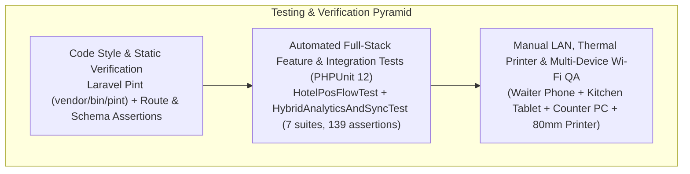

# Testing & QA Strategy (`TESTING.md`) — Royal Hotel & Restaurant Hybrid POS

## 1. Testing Philosophy & Test Pyramid

Royal Hotel & Restaurant Hybrid POS spans two critical operational boundaries:
1. **75% Offline Mission-Critical Dining Floor**: Zero GST/discount rounding errors, zero downtime during internet outages, and strict role isolation between Waiter, Kitchen, Cashier, and Owner.
2. **25% Cloud AI, Nightly Sync & Investor Portal**: Idempotent daily snapshot upserts, constant-time Bearer + HMAC-SHA256 verification, resilient Google Gemini API fallback when offline, and zero customer PII leakage on public `/investor/{token}` links.



---

## 2. Test Environment & Tooling Commands

Configured in [phpunit.xml](file:///d:/planned%20projects/hotel-pos-laravel/phpunit.xml) using an isolated in-memory SQLite database (`DB_CONNECTION=sqlite`, `DB_DATABASE=:memory:`), `RefreshDatabase`, `DatabaseSeeder`, and `Http::fake()` so tests execute in **under 3 seconds with zero external network calls**:

```powershell
# Run the complete automated test suite
php artisan test --compact

# Run Core 75% Offline POS flow tests
php artisan test --compact tests/Feature/HotelPosFlowTest.php

# Run Hybrid 25% Cloud AI, Nightly Sync & Investor Portal tests
php artisan test --compact tests/Feature/HybridAnalyticsAndSyncTest.php

# Run a single test method by name
php artisan test --compact --filter=test_complete_hotel_pos_lifecycle_across_all_roles

# Enforce Laravel Pint code style across modified PHP files
vendor/bin/pint --dirty --format agent
```

---

## 3. Critical Automated Test Scenarios (`tests/Feature/`)

### 3.1 Core 75% Offline POS Suite ([tests/Feature/HotelPosFlowTest.php](file:///d:/planned%20projects/hotel-pos-laravel/tests/Feature/HotelPosFlowTest.php))

| Test Method | Verified Scenarios & Assertions |
|---|---|
| `test_complete_hotel_pos_lifecycle_across_all_roles` | 1. Unauthenticated `GET /waiter` redirects to `/login`.<br>2. Waiter (`4444`) logs in and is blocked (`302`) from `/owner` and `/counter`.<br>3. Waiter punches KOT on Table `T1` (`2x Paneer Butter Masala @ ₹240` + `4x Butter Naan @ ₹45` = Subtotal `₹660`, CGST `₹16.50`, SGST `₹16.50`, Grand Total `₹693`).<br>4. Kitchen (`3333`) polls `GET /api/kitchen/live`, sees `pending = 1`, transitions KOT `preparing` → `ready`, and Waiter requests bill (`status = billing`).<br>5. Cashier (`2222`) transfers `T1 → T2`, cancels `Butter Naan` with anti-theft reason (`Subtotal = ₹480`), applies `₹80` flat discount (`Taxable = ₹400`, `5% GST = ₹20`, `Grand Total = ₹420`), and settles via Split Payment (`₹200 Cash + ₹220 UPI`).<br>6. Verifies thermal receipt (`GET /print/bill/{order}`), Owner (`1111`) dashboard KPIs (`₹420`), UTF-8 CSV export, JSON database backup, and `audit_logs` records (`kot_sent`, `item_cancelled`, `discount_applied`, `table_transferred`, `bill_settled`). |
| `test_cashier_can_create_and_cancel_takeaway_parcel_order` | 1. Cashier (`2222`) creates Takeaway Parcel order (`order_type = takeaway`).<br>2. Adds `1x Chicken Dum Biryani` (`KOT` created).<br>3. Cancels entire unpaid order with mandatory reason (`Customer walked out`).<br>4. Asserts `orders.status = cancelled` and `audit_logs` contains `order_cancelled`. |

### 3.2 Hybrid 25% Cloud AI, Nightly Sync & Investor Portal Suite ([tests/Feature/HybridAnalyticsAndSyncTest.php](file:///d:/planned%20projects/hotel-pos-laravel/tests/Feature/HybridAnalyticsAndSyncTest.php))

| Test Method | Verified Scenarios & Assertions |
|---|---|
| `test_owner_analytics_dashboard_builds_offline_snapshots_and_ enforces_rbac` | 1. Blocks Waiter (`4444`) from `/owner/analytics`.<br>2. Settles Dine-In (`Cash`) and Parcel (`UPI`) orders.<br>3. Owner (`1111`) loads `/owner/analytics?range=30days`.<br>4. Asserts `daily_analytics_snapshots` rollup (`total_orders = 2`, `dine_in = 1`, `takeaway = 1`, accurate `net_revenue`, `cash_total`, `upi_total`) and SVG chart container IDs (`chart-revenue-trend`, `chart-payment-pie`, `chart-category-pie`). |
| `test_ai_insights_support_offline_fallback_and_google_gemini_interactions_api` | 1. **Zero-Key Offline Fallback**: Calls `POST /owner/analytics/generate-ai` with empty `gemini_api_key` and asserts `provider = local_fallback`, `model_name = statistical-engine-v1`.<br>2. **Live Gemini Interactions API v1**: Configures `gemini_api_key`, fakes `POST https://generativelanguage.googleapis.com/v1/interactions`, verifies `x-goog-api-key` header and `gemini-4-hydrogen` model, and asserts parsed `AiInsightReport` (`provider = gemini`, `health_score = 89`).<br>3. **503 Resilience Fallback**: Simulates HTTP `503` Gemini outage and verifies graceful fallback to `local_fallback`. |
| `test_nightly_cloud_sync_command_queues_offline_failures_and_syncs_on_retry` | 1. Simulates HTTP `503` on `php artisan pos:sync-cloud --days=3` → asserts command returns exit code `1`, snapshot marked `sync_status = failed`, `sync_attempts = 1`.<br>2. Simulates HTTP `200` on retry → verifies `Authorization: Bearer`, `X-POS-Outlet-Code`, and `X-POS-Signature` headers, asserts snapshot marked `synced` and `CloudSyncLog` recorded. |
| `test_cloud_hub_ingests_multi_outlet_snapshots_and_rejects_invalid_token` | 1. Asserts `POST /api/cloud/sync` with wrong Bearer token returns HTTP `401`.<br>2. Signs a valid HMAC-SHA256 payload for sister branch `ROYAL-PUN-02` (`Royal Hotel — Pune Deccan`) and asserts HTTP `200` (`upserted = 1`).<br>3. Asserts `GET /api/cloud/health` reports `mode = cloud_hub` and `outlets_connected = 2`, and `/owner/analytics` benchmarks both Yavatmal and Pune outlets. |
| `test_investor_share_portal_is_read_only_tracks_views_hides_pii_and_supports_revocation` | 1. Owner creates a tokenized share link (`POST /owner/analytics/share-links`).<br>2. Logs out completely and visits `GET /investor/{token}` as an unauthenticated external investor.<br>3. Asserts `views_count = 1`, KPIs & AI narrative render, and customer phone number (`9998887776`) is **absent** from the HTML response.<br>4. Owner toggles link off (`PATCH /owner/analytics/share-links/{id}/toggle`) → subsequent visit to `/investor/{token}` returns HTTP `404`. |

---

## 4. Fixtures, Mocks & Test Isolation Strategy

- **Database Seeding Fixture**: Both test classes invoke `$this->seed(DatabaseSeeder::class)` inside `setUp()`, providing a deterministic baseline of 5 staff accounts, 14 tables, 6 categories, and 29 dishes.
- **External HTTP Isolation (`Http::fake()`)**: All calls to `generativelanguage.googleapis.com` and remote `cloud_sync_url` endpoints are intercepted via Laravel's `Http::fake()`, allowing deterministic testing of 200 OK, 401 Unauthorized, and 503 Service Unavailable paths offline.

---

## 5. Manual Hardware, LAN & Print QA Checklist

| QA Area | Step-by-Step Verification Procedure | Expected Result |
|---|---|---|
| **Offline WAN Disconnect Test** | Unplug internet WAN cable from Wi-Fi router; run full Waiter (`4444`) → Kitchen (`3333`) → Counter (`2222`) → Owner Analytics (`1111`) workflow. | All screens, 3s KDS chime, SVG charts, and statistical AI reports work with 0 console or network errors. |
| **80mm & 58mm Thermal Print** | Toggle `Paper Width` between `80mm` and `58mm` in Owner → Settings; print `/print/bill/{order}` and `/print/kot/{kot}`. | Clean monochrome alignment, no horizontal clipping, action buttons hidden in `@media print`. |
| **Port `6808` & `6707` Coexistence** | Run `Activate-Hotel-POS-6808.bat` on the Windows host. | Both `http://127.0.0.1:6808/up` and `http://127.0.0.1:6707/up` return `HTTP 200 OK`. |
| **Windows Nightly Task Scheduler** | Run `Setup-Nightly-Cloud-Sync.bat` as Administrator, then run `schtasks /Query /TN "RoyalHotelPOS_NightlyCloudSync"`. | Scheduled task is registered for `01:00 AM` daily. |
| **Investor PDF Export** | Open `/investor/{token}` in an incognito window and click **Print / Save Investor PDF**. | Crisp multi-page A4 PDF with vector SVG charts and zero staff nav or PII. |

---

## 6. Continuous Verification & Release Quality Gate

Before any commit or deployment is marked complete:
1. `vendor/bin/pint --dirty --format agent` passes with **0 style issues**.
2. `php artisan test --compact` passes **100% (7 tests, 139 assertions)**.
3. `php artisan migrate --force` applies cleanly with zero pending migrations.
4. `GET /up` and `GET /api/cloud/health` return HTTP `200 OK`.
