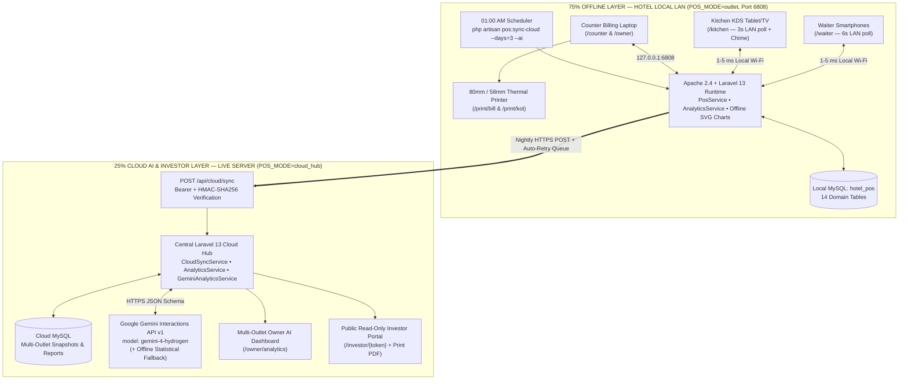
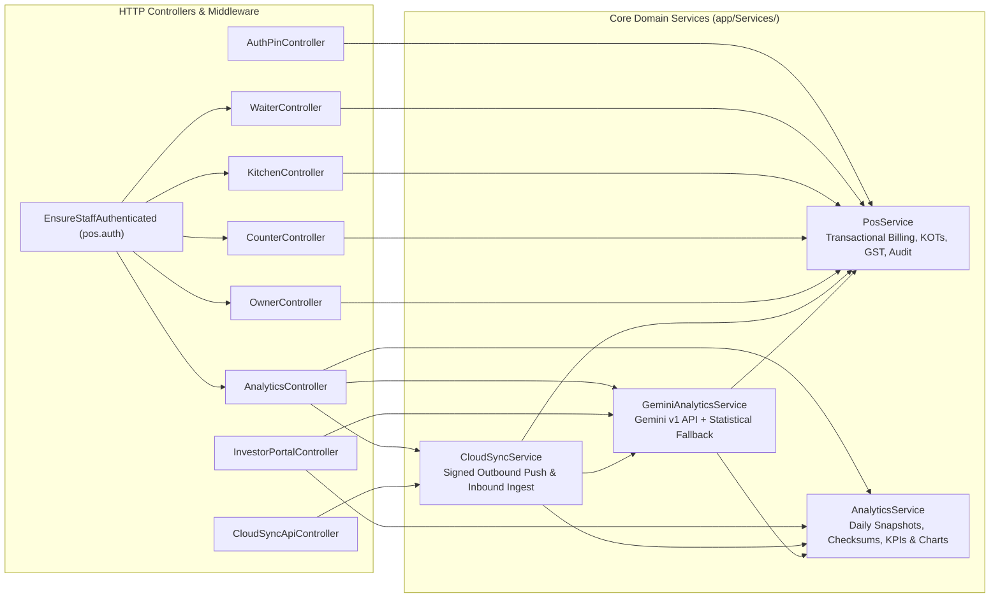

# System Architecture & Technical Requirements (`ARCHITECTURE.md` / `TRD.md`) — Royal Hotel & Restaurant Hybrid POS

## 1. High-Level Hybrid Architecture (75% Offline / 25% Cloud AI)

Royal Hotel POS uses a **Dual-Mode single Laravel 13 codebase** (`POS_MODE=outlet | cloud_hub`) that separates mission-critical real-time floor execution (75% offline LAN) from nightly multi-outlet intelligence & investor sharing (25% online cloud):

---

## 2. Technology Stack

| Layer | Technology | Version / Notes |
|---|---|---|
| **Backend Framework** | Laravel Framework | `^13.17` |
| **Language Runtime** | PHP | `^8.3` (verified on `PHP 8.5.12`) |
| **Production Database** | MySQL / MariaDB | Local DB `hotel_pos` on XAMPP + Cloud MySQL on Cloud Hub |
| **Test Database** | SQLite | In-memory (`:memory:`) via `phpunit.xml` |
| **Web Server** | Apache 2.4 (XAMPP) / Cloud Nginx+PHP-FPM | Local port `6808` (coexists cleanly with Driving School port `6707`) |
| **Frontend & Charts** | Blade + `public/css/pos.css` + `public/js/pos-charts.js` | Zero-CDN custom interactive SVG charts (100% offline-capable) |
| **AI Engine** | Google Gemini Interactions API (`v1`) | `POST https://generativelanguage.googleapis.com/v1/interactions`, default `gemini-4-hydrogen`, JSON Schema structured output + automatic local statistical fallback |
| **Testing & Tooling** | PHPUnit `^12.5`, Laravel Pint `^1.27`, Laravel Boost `^2.10` | `php artisan test --compact`, `vendor/bin/pint`, `.mcp.json` |

---

## 3. Module & Service Boundaries

| Service / Component | Responsibility Boundary |
|---|---|
| `App\Services\PosService` | Owns all mutations to `orders`, `kots`, `order_items`, `dining_tables.status`, and `audit_logs`. Wraps every multi-row write in `DB::transaction()`. Computes CGST, SGST, discounts, nearest-rupee round-off, split payment allocation, and `formatINR()`. |
| `App\Services\AnalyticsService` | Owns `outlets` registration (`ensureLocalOutlet`), daily aggregation (`buildDailySnapshot`), SHA-256 `payload_checksum` change detection, date-range snapshot synchronization, Period-over-Period growth %, Annualized Run Rate (ARR), and chart payload construction. |
| `App\Services\GeminiAnalyticsService` | Owns executive AI report generation (`generateReport`). Formats compact zero-PII telemetry for Google Gemini Interactions API v1 and automatically falls back to `buildStatisticalFallback()` on offline/error conditions. |
| `App\Services\CloudSyncService` | Owns outbound signed snapshot transmission (`syncOutbound`), failure retry marking (`markSnapshotsFailed`), and authenticated inbound Cloud Hub ingestion (`ingestInbound`). |

---

## 4. Data Flow & State Management

1. **Session & Auth State**:
   - Stored in database-backed sessions (`SESSION_DRIVER=database`) keyed by `pos_staff_id`.
   - `EnsureStaffAuthenticated` resolves the active `StaffUser` on every request and shares `$currentStaff` across all Blade views.
2. **Real-Time LAN State Synchronization**:
   - Kitchen KDS polls `GET /api/kitchen/live` every **3 seconds** (`1–5 ms` local LAN round-trip) and compares `latest_kot_id` in browser memory to trigger Web Audio chime notifications.
   - Waiter Floor Map polls `GET /api/waiter/tables` every **6 seconds** to update table colors, running INR totals, and `READY` KOT badges.
   - Billing Counter polls `GET /api/counter/live` to update active order counts, bill requests, and today's settled sales total.
3. **Immutable Historical Snapshots**:
   - `order_items` snapshot `item_name`, `unit_price`, and `is_veg` at the moment a KOT is punched so future menu edits in `/owner/menu` never alter historical bills.
   - `daily_analytics_snapshots` store a SHA-256 `payload_checksum` of all aggregated daily metrics; any same-day settlement changes the checksum and marks `sync_status = 'pending'`.

---

## 5. Performance, Scalability & Operational Constraints

- **Zero External Asset Blocking**: Because Indian hotels frequently experience intermittent broadband or captive-portal drops while the local Wi-Fi router stays up, the UI loads **zero** external Google Fonts, Tailwind CDNs, or Chart.js CDNs. Every byte of CSS (`public/css/pos.css`) and SVG charting JS (`public/js/pos-charts.js`) is served from local Apache in `< 15 ms`.
- **Port `6808` Coexistence Constraint**: The local XAMPP Apache 2.4 server binds port `6808` so existing local services (such as the Driving School Portal on port `6707`) continue running side by side without port conflicts.
- **Database Compatibility Constraint**: All analytical queries avoid MySQL-only SQL functions in favor of portable Eloquent/Carbon constructs (`whereDate`, collection grouping) so the entire test suite runs in `< 2.5 seconds` on in-memory SQLite while production runs on MySQL.

---

## 6. Cross-References to Detailed Specifications

- **Database ER Diagram & 14 Table Schemas**: See [docs/database.md](file:///d:/planned%20projects/hotel-pos-laravel/docs/database.md)
- **Full Web, LAN Polling & Cloud Sync API Contracts**: See [docs/api.md](file:///d:/planned%20projects/hotel-pos-laravel/docs/api.md)
- **Design Tokens, UI Layouts & Offline SVG Charts**: See [docs/design.md](file:///d:/planned%20projects/hotel-pos-laravel/docs/design.md)
- **Authentication, RBAC, HMAC & Zero-PII Security**: See [docs/security.md](file:///d:/planned%20projects/hotel-pos-laravel/docs/security.md)
